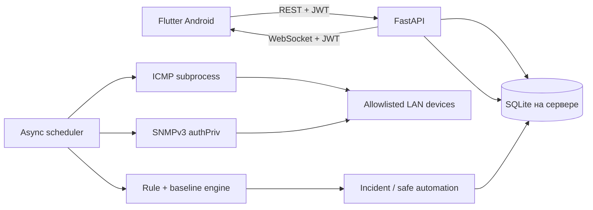
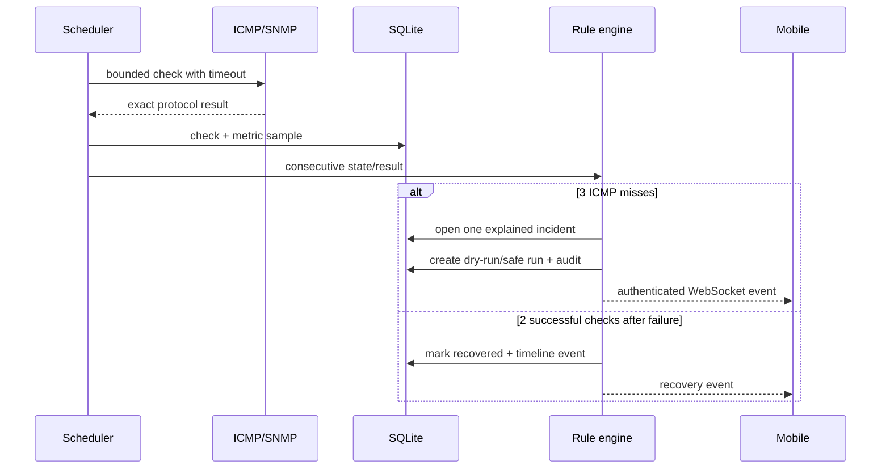
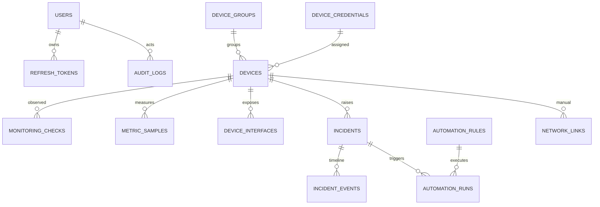

# Архитектура ISMN

## Назначение и границы

Цель — наблюдать только зарегистрированные администратором узлы принадлежащей ему LAN, сохранять факты наблюдения и выполнять лишь ограниченные, аудируемые реакции. Телефон является панелью; мониторинг выполняется сервером.

Backend разделён на API, core/security, SQLAlchemy DB, monitoring, automation, services и Pydantic schemas. Flutter разделён на app, core (API/auth/config/repository/router) и feature screens.

## Поток проверки и инцидента

## Основные сущности

Также существуют `alert_rules`, `notifications`, `app_settings`. Внешние ключи SQLite включены через `PRAGMA foreign_keys=ON`; критичные поля индексированы.

## Протоколы

- REST/JSON и OpenAPI — управление и polling fallback.
- WebSocket — live events с access token.
- ICMP — только достижимость, фиксированное число пакетов и timeout.
- SNMPv3 authPriv — стандартные поддерживаемые OID; SNMPv2c в core не включён.
- SSH — архитектурно предусмотрен, но произвольные/непроверенные команды не реализованы. UI/API честно блокирует такую попытку.

## Объяснимая «интеллектуальность»

Core использует детерминированные правила, гистерезис и функцию moving median baseline. Каждое событие хранит наблюдение и объяснение. При менее чем 10 образцах baseline возвращает «Недостаточно данных». Это не ML и проект этого не заявляет.

## Функциональные требования

Регистрация устройств, фоновые проверки, история, состояния, инциденты, live events, RBAC, отчёты, ручная топология, аудит и безопасная автоматизация. Нефункциональные: local-first, восстановление после рестарта, bounded concurrency, отсутствие plaintext-секретов в API, русская доступная UI, явное разделение real/simulated.

